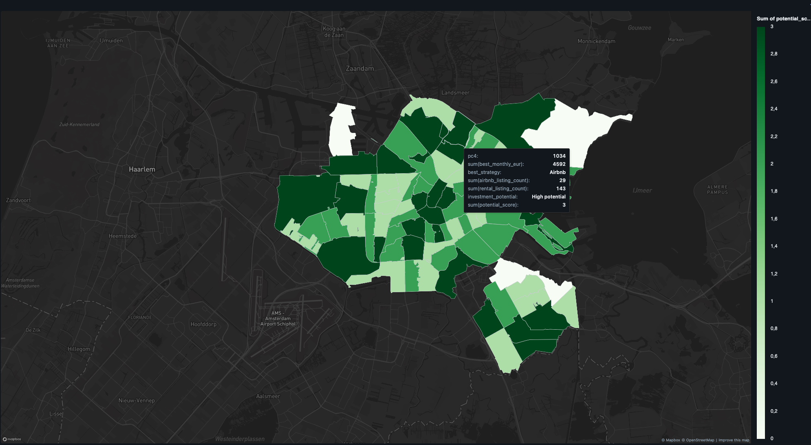

# Amsterdam Rental Revenue Pipeline

A Medallion Architecture data pipeline comparing short-term Airbnb and long-term Kamernet rental revenue per Amsterdam postcode, to identify postcodes with the highest investment potential.

## Business question

> For each Amsterdam postcode, is listing a property on Airbnb or renting it long-term through Kamernet more profitable?

---

## Architecture

The pipeline follows the [Medallion Architecture](https://www.databricks.com/glossary/medallion-architecture) (Bronze → Silver → Gold) and is designed to run on Databricks.

```
data/airbnb.csv          ─┐
data/rentals.json         ├─► Bronze (raw Delta) ─► Silver (clean Delta) ─► Gold (revenue Delta + Parquet)
data/geo/*.geojson        ─┘ (geo: raw files only, see below)
```

### Bronze
Ingests `airbnb.csv` and `rentals.json` as-is into Delta tables with an ingestion timestamp. No transformation — bronze preserves raw fidelity so the Silver cleaning logic can be changed without data loss.

Geographic reference files (`post_codes.geojson`, `amsterdam_areas.geojson`) are intentionally excluded from Bronze. They are already clean, versioned in the repo alongside the zip originals, and consumed directly as raw assets in the Silver zipcode backfill. Routing them through Delta would add ingestion cost without adding value.

### Silver
Applies business rules and produces clean, typed, Amsterdam-scoped tables:

- **Rentals**: filtered to `city == 'Amsterdam'` (the source dataset covers all of the Netherlands). Filtering here rather than Bronze preserves raw fidelity and keeps the business rule in the transformation layer where it belongs.
- **Airbnb**: price outliers capped at the IQR upper fence (chosen over z-score because nightly prices are right-skewed — the long tail inflates the std and makes z-score under-flag; see [`notebooks/00_eda.ipynb`](notebooks/00_eda.ipynb) for the IQR vs z-score agreement crosstab); **22.7% of rows had no zipcode** — backfilled via point-in-polygon lookup against `post_codes.geojson` using a broadcast UDF, recovering all rows that had valid coordinates.
- Raw string fields (`rent`, `deposit`, `areaSqm`) parsed to numeric types; single-element list fields in the Kamernet JSON flattened to scalars.

Zipcodes were transformed to PC4 (the 4-digit prefix of a Dutch `NNNNAA` postcode) because:
- Airbnb's `zipcode` field is already truncated to PC4 in the source CSV (`1053`, not `1053AB`), so joining on the full PC6 would match nothing.
- The `post_codes.geojson` used for lat/lon backfill contains PC4 polygons only, so recovered zipcodes can't be more granular than PC4 anyway.
- PC6 is street-segment scale (~20 addresses); aggregating revenue at that grain would produce many postcodes with 1–2 listings and unstable medians. PC4 is neighbourhood-scale and gives statistically meaningful per-postcode comparisons.

### Gold
Calculates estimated monthly revenue per listing and aggregates by postcode:

- **Airbnb monthly revenue** = `nightly_price × 365 × 0.66 / 12`
  — 66% occupancy rate per [AirDNA Amsterdam market data](https://www.airdna.co/vacation-rental-data/app/nl/default/amsterdam/overview), applied as a city-wide average. Actual occupancy varies by neighbourhood, property type, and season.
- **Rental monthly revenue** = `rent + additional_costs`
- Output: `revenue_per_postcode` table with average revenue per source, listing counts, and a `recommendation` column (airbnb / rental / neutral).

---

## Dashboard



Investment potential per PC4 postcode, ranked by the highest achievable monthly rental income (no sale-price data is available, so income is the proxy). Dark green = top third of postcodes (High potential), lighter = Medium / Low, white = fewer than 5 listings, not scored. Airbnb out-earns long-term rental in every postcode, so the ranking is driven by expected Airbnb income.

Build steps and the dataset SQL are in [docs/dashboard.md](docs/dashboard.md).

---

## Repository structure

```
notebooks/          Pipeline notebooks (run in order: 01 → 02 → 03)
  00_eda.ipynb      Exploratory analysis — data quality findings that informed Silver design (not part of the job)
  01_bronze.ipynb   Raw ingestion
  02_silver.ipynb   Cleaning, filtering, zipcode backfill
  03_gold.ipynb     Revenue calculation and postcode aggregation

src/amsterdam_rental/
  transforms.py     Pure Python transform functions (no Spark dependency)
  geo.py            PostcodeIndex — point-in-polygon zipcode backfill

tests/
  test_transforms.py  Unit tests for all transform functions
  test_geo.py         Unit tests for PostcodeIndex with GeoJSON fixture

resources/
  pipeline_job.yml  Databricks Asset Bundle job configuration

.pre-commit-config.yaml  Lint/format hooks (ruff, nbstripout, file hygiene)

data/
  airbnb.zip        Source: Airbnb listings (nightly price, location, room type)
  rentals.zip       Source: Kamernet rentals (monthly rent, Amsterdam + rest of NL)
  geo/
    post_codes.zip        474 PC4 postcode polygons (greater Amsterdam)
    amsterdam_areas.zip   99 neighbourhood polygons (Amsterdam only)
  output/           Pipeline output (Delta tables + Parquet exports) — gitignored
```

**Why `src/` is separate from the notebooks:** the transform and geo logic lives in a plain Python package so it can be unit-tested with pytest without Spark or a cluster. The notebooks and the tests both import it by adding `src/` to `sys.path`. It is not packaged as a wheel on purpose: the code is used by a single job in a single repo, so a wheel would add a build step and a serverless environment dependency without any benefit. Packaging becomes worth it once the library is shared across jobs or repos, or needs its own version.

---

## Running the pipeline

There are three ways to run this, in order of recommendation.

### Option A — Databricks Asset Bundle (CLI)

The productionized path. Deploys the three notebooks as a single multi-task job defined in [resources/pipeline_job.yml](resources/pipeline_job.yml), running Bronze → Silver → Gold on **serverless compute** (no cluster definition required — Databricks provisions and tears down the runtime automatically).

**Prerequisites**

- Databricks CLI v0.200+ ([install docs](https://docs.databricks.com/en/dev-tools/cli/install.html)):
  ```bash
  brew tap databricks/tap && brew install databricks/tap/databricks
  # or direct binary download from https://github.com/databricks/cli/releases
  ```
- Access to a Databricks workspace. The workspace host is set in [databricks.yml](databricks.yml) — edit if yours differs.

**Steps**

1. **Authenticate** (one-time, interactive):
   ```bash
   databricks auth login --host https://dbc-daf2e406-b82e.cloud.databricks.com
   ```
   Opens a browser for OAuth. Alternatively, `databricks configure` for a Personal Access Token.

2. **Validate the bundle** — catches YAML and DAG errors before touching the workspace:
   ```bash
   databricks bundle validate
   ```

3. **Deploy** — uploads the notebooks to `/Workspace/Users/<you>/.bundle/amsterdam_rental/dev/` and creates the job via the Jobs API:
   ```bash
   databricks bundle deploy
   ```

4. **Run** — triggers the job, streams status, prints a workspace URL for the run:
   ```bash
   databricks bundle run amsterdam_rental_pipeline
   ```
   One cluster is spun up, all three tasks run on it sequentially, then it is torn down.

5. **(Optional) Tear down**:
   ```bash
   databricks bundle destroy
   ```

**Useful flags**

- `--only <task_key>` — run just one task (e.g. `--only bronze_ingestion`).
- `--no-wait` — return immediately with the run URL for background execution.
- `-t prod` — target a different environment (see `targets:` in [databricks.yml](databricks.yml)).

### Option B — Databricks Repo (interactive)

Best for exploratory work or iterating on a single notebook.

1. Import this repository into a Databricks Repo.
2. Unzip the source files in `data/` — or let the notebooks handle it automatically (they detect and extract from zip if the unzipped file is absent).
3. Create a Unity Catalog volume at `/Volumes/workspace/default/amsterdam_rental` or update `OUTPUT_ROOT` in each notebook's setup cell.
4. Run notebooks in order: `01_bronze` → `02_silver` → `03_gold`.
5. (Optional) Build a dashboard to visualise the gold table — see [docs/dashboard.md](docs/dashboard.md).

### Option C — Local (PySpark)

For running unit tests or working on transform logic without a Databricks workspace.

```bash
pip install pyspark delta-spark pytest
python -m pytest tests/        # run unit tests
# then open and run notebooks in order using Jupyter
```

**Pre-commit hooks** (ruff lint + format for `.py` and `.ipynb`, nbstripout, file hygiene):

```bash
pip install pre-commit
pre-commit install             # run hooks on every commit
pre-commit run --all-files     # run once across the repo
```

---

## Known limitations

| Limitation | Detail |
|---|---|
| Rentals data age | Kamernet dataset was scraped in 2019 — revenue estimates reflect that market, not current prices |
| Uniform occupancy rate | 66% applied to all Airbnb listings; in reality varies significantly by neighbourhood and property type |
| No actual occupancy data | Airbnb dataset contains nightly prices only — occupancy is estimated, not measured |
| Geo backfill boundary | Point-in-polygon only covers postcodes in `post_codes.geojson`; listings outside greater Amsterdam return null |
