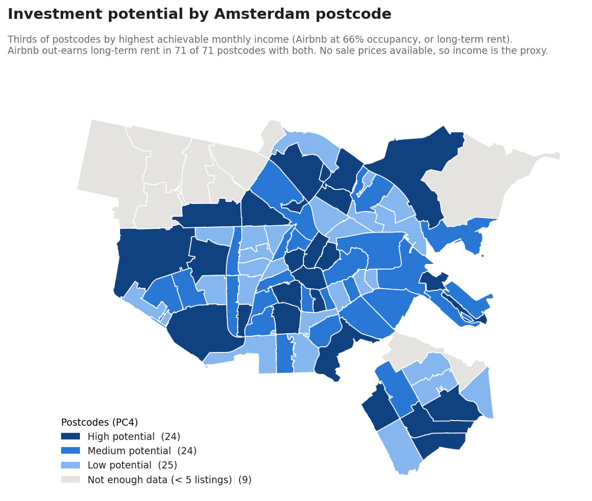

# Amsterdam Rental Revenue Pipeline

A Medallion Architecture data pipeline comparing short-term Airbnb and long-term Kamernet rental revenue per Amsterdam postcode, to identify postcodes with the highest investment potential.

## Business question

> For each Amsterdam postcode, is listing a property on Airbnb or renting it long-term through Kamernet more profitable?

---

## Result



Generated by [`notebooks/04_report.ipynb`](notebooks/04_report.ipynb), the last task of the pipeline job, from the gold `revenue_per_postcode` table. Postcodes are split into thirds by their highest achievable monthly rental income (no sale-price data is available, so income is the proxy). Grey = fewer than 5 listings, not scored. Airbnb out-earns long-term rental in every postcode that has both, so the ranking is driven by expected Airbnb income.

To refresh the image after a run, see [Updating the README map](#updating-the-readme-map). An optional interactive AI/BI dashboard on the same table is described in [docs/dashboard.md](docs/dashboard.md).

---

## Quickstart (Databricks, ~5 minutes)

**You need:** a Databricks workspace with Unity Catalog and serverless jobs (Free Edition works), permission to create a schema in a catalog, and the [Databricks CLI](https://docs.databricks.com/en/dev-tools/cli/install.html) (tested with v1.22).

```bash
git clone <this repo> && cd assessment-rent-airbnb

databricks auth login --host https://<your-workspace>.cloud.databricks.com   # one-time
databricks bundle validate
databricks bundle deploy
databricks bundle run amsterdam_rental_pipeline
```

That's all. No manual uploads, volumes or path edits:

- The source data (`data/*.gz`) is deployed with the code (`sync.include` in [databricks.yml](databricks.yml)). It is gzipped rather than zipped because Databricks unpacks `.zip` files on upload, so zips never arrive in a bundle deployment.
- The bronze task creates the schema and volume if they don't exist and decompresses the sources into the volume.
- Everything lands in `<catalog>.amsterdam_rental`: Delta and Parquet outputs and the map PNG in the volume `pipeline`, plus the gold tables `revenue_per_postcode`, `revenue_per_listing` and `pc4_geometry`.

**Choosing where it writes.** By default the pipeline uses your workspace's **default catalog**. Override any of the three bundle variables:

```bash
databricks bundle deploy --var catalog=main --var schema=amsterdam_rental --var volume=pipeline
databricks bundle run amsterdam_rental_pipeline
```

If the workspace's default catalog is `hive_metastore` (no Unity Catalog), the bronze task stops with a message asking you to pass `--var catalog=<uc_catalog>`.

**Other useful commands**

- `databricks bundle run amsterdam_rental_pipeline --only gold_revenue`: re-run one task
- `databricks bundle deploy -t prod`: production target (no dev prefix, deployed under `.bundle/amsterdam_rental/prod`)
- `databricks bundle destroy`: remove the job and deployed files. The schema and volume stay; drop them with `DROP SCHEMA <catalog>.amsterdam_rental CASCADE`.

### Updating the README map

The job writes the map to the volume. Copy it into the repo:

```bash
databricks fs cp --overwrite \
  dbfs:/Volumes/<catalog>/amsterdam_rental/pipeline/figures/investment_potential_map.png \
  docs/images/investment_potential_map.png
```

### Running notebooks interactively (Git folder)

1. **Workspace → Create → Git folder**, paste the repo URL.
2. Open the notebooks in order (`01_bronze` → `02_silver` → `03_gold` → `04_report`) and **Run all**.

Each notebook shows `catalog`, `schema`, `volume` and `repo_root` widgets at the top. Leave them blank or at their defaults to use the workspace's default catalog, or set them to match a bundle deployment.

---

## Running locally

**Unit tests** (no Spark or Java needed):

```bash
pip install -r requirements-dev.txt
python -m pytest tests/
```

**Full pipeline locally** (needs Java 17 for PySpark): install the same requirements, then run the notebooks in `notebooks/` in order with Jupyter. Outputs go to `data/output/`, and `04_report` writes the map straight to `docs/images/investment_potential_map.png`. Unity Catalog registration is skipped locally.

**Pre-commit hooks** (ruff lint + format for `.py` and `.ipynb`, nbstripout, file hygiene):

```bash
pre-commit install             # run hooks on every commit
pre-commit run --all-files     # run once across the repo
```

---

## Architecture

The pipeline follows the [Medallion Architecture](https://www.databricks.com/glossary/medallion-architecture) (Bronze → Silver → Gold), followed by a report task:

```
data/*.gz ─► stage into volume ─► Bronze (raw Delta) ─► Silver (clean Delta) ─► Gold (Delta + Parquet + UC tables) ─► Report (map PNG)
```

### Configuration
All notebooks share one setup cell and [`src/amsterdam_rental/config.py`](src/amsterdam_rental/config.py). The catalog, schema and volume come from job parameters, which the bundle sets from its variables. When a notebook runs interactively, they come from the widgets instead. All paths derive from those three values, so the code contains no workspace-specific values.

### Bronze
Creates the schema and volume on first run, then decompresses the source files into the volume (Spark on serverless cannot read workspace files directly). Ingests `airbnb.csv` and `rentals.json` as-is into Delta tables with an ingestion timestamp. No transformation: bronze preserves raw fidelity so the Silver cleaning logic can be changed without data loss.

The geographic reference file (`post_codes.geojson`) is staged alongside but intentionally not ingested into Bronze. It is already clean, versioned in the repo, and consumed directly as a raw asset in the Silver zipcode backfill and the Gold geometry join. Routing it through Delta would add ingestion cost without adding value.

### Silver
Applies business rules and produces clean, typed, Amsterdam-scoped tables:

- **Rentals**: filtered to `city == 'Amsterdam'` (the source dataset covers all of the Netherlands). Filtering here rather than Bronze preserves raw fidelity and keeps the business rule in the transformation layer where it belongs.
- **Airbnb**: price outliers capped at the IQR upper fence. IQR was chosen over z-score because nightly prices are right-skewed: the long tail inflates the std, so z-score under-flags (see [`notebooks/00_eda.ipynb`](notebooks/00_eda.ipynb) for the IQR vs z-score agreement crosstab).
- **Airbnb zipcodes**: **22.7% of rows had no zipcode**. These are backfilled via a point-in-polygon lookup against `post_codes.geojson`.
  - Stated zipcodes are also validated: kept if they are an Amsterdam PC4, otherwise replaced by the PC4 the coordinates fall in. This fixes typos and placeholders such as `1212AB` on an Oud-Zuid listing.
  - Listings whose zipcode and coordinates are both outside the Amsterdam municipality (Diemen, Amstelveen, Haarlemmermeer, …; 24 rows) are dropped, the same rule as the rentals city filter.
  - Coordinates don't override valid zipcodes, because Airbnb jitters them by up to ~150 m, which puts ~21% of listings in a neighbouring PC4.
- Raw string fields (`rent`, `deposit`, `areaSqm`) parsed to numeric types; single-element list fields in the Kamernet JSON flattened to scalars.

Zipcodes were transformed to PC4 (the 4-digit prefix of a Dutch `NNNNAA` postcode) because:
- Airbnb's `zipcode` field is inconsistent (`1053`, `1053.0`, `1053 AB`, `1183aj`); only the PC4 part is reliably present, so joining on the full PC6 would match little.
- The `post_codes.geojson` used for lat/lon backfill contains PC4 polygons only, so recovered zipcodes can't be more granular than PC4 anyway.
- PC6 is street-segment scale (~20 addresses); aggregating revenue at that grain would produce many postcodes with 1–2 listings and unstable medians. PC4 is neighbourhood-scale and gives statistically meaningful per-postcode comparisons.

### Gold
Calculates estimated monthly revenue per listing and aggregates by postcode:

- **Airbnb monthly revenue** = `nightly_price × 365 × 0.66 / 12`
  — 66% occupancy rate per [AirDNA Amsterdam market data](https://www.airdna.co/vacation-rental-data/app/nl/default/amsterdam/overview), applied as a city-wide average. Actual occupancy varies by neighbourhood, property type, and season.
- **Rental monthly revenue** = `rent + additional_costs`
- **Investment potential**: postcodes ranked by `best_monthly_eur` (the higher of the Airbnb and rental averages) and split into thirds with `NTILE(3)`: High / Medium / Low. Postcodes with fewer than 5 listings get *Not enough data*.
- Output: `revenue_per_postcode` (averages per source, listing counts, `recommendation`, `investment_potential`, PC4 geometry) and `revenue_per_listing`, as Delta, Parquet and Unity Catalog tables.

### Report
Reads the gold table and renders the investment-potential map with matplotlib ([`src/amsterdam_rental/plotting.py`](src/amsterdam_rental/plotting.py)). The PNG goes to `figures/` in the volume (locally: `docs/images/`).

---

## Repository structure

```
databricks.yml        Bundle: variables (catalog / schema / volume), sync of the gzipped data, targets
resources/
  pipeline_job.yml    Job: bronze → silver → gold → report on serverless, with job parameters

notebooks/            Pipeline notebooks (run in order: 01 → 04)
  00_eda.ipynb        Exploratory analysis behind the Silver design (not part of the job)
  01_bronze.ipynb     Create schema + volume, stage sources, raw ingestion
  02_silver.ipynb     Cleaning, Amsterdam filter, zipcode validation + backfill
  03_gold.ipynb       Revenue per listing / postcode, investment-potential tiers, UC tables
  04_report.ipynb     Investment-potential map (the image in this README)

src/amsterdam_rental/
  config.py           Paths, catalog resolution and source staging (no workspace hardcoding)
  transforms.py       Pure Python transform functions (no Spark dependency)
  geo.py              PostcodeIndex: point-in-polygon zipcode validation + backfill
  plotting.py         Static choropleth renderer used by 04_report

tests/                Unit tests for config, transforms, geo and plotting

data/                 Source data, gzipped and deployed with the bundle
  airbnb.csv.gz       Airbnb listings (nightly price, location, room type)
  rentals.json.gz     Kamernet rentals (monthly rent, Amsterdam + rest of NL)
  geo/post_codes.geojson.gz       474 PC4 postcode polygons (greater Amsterdam)
  geo/amsterdam_areas.geojson.gz  99 neighbourhood polygons (not used by the pipeline)
  output/             Local pipeline output (gitignored)

docs/
  dashboard.md        Optional interactive AI/BI dashboard on the gold table
  images/             README map (output of 04_report)
  ai-sessions/        Exports of the AI-assisted (Claude Code) working sessions

requirements-dev.txt  Local dependencies (tests, local Spark, plotting, pre-commit)
```

---

## How this was built

The work was done with Claude Code as a pair programmer. The session exports in [docs/ai-sessions/](docs/ai-sessions/) record the prompts, the proposed options, and which decisions were mine (with a decision log per session).

---

## Known limitations

| Limitation | Detail |
|---|---|
| Rentals data age | Kamernet dataset was scraped in 2019, so revenue estimates reflect that market, not current prices |
| Uniform occupancy rate | 66% applied to all Airbnb listings; in reality it varies significantly by neighbourhood and property type |
| No actual occupancy data | The Airbnb dataset contains nightly prices only, so occupancy is estimated, not measured |
| Geo backfill boundary | Point-in-polygon only covers postcodes in `post_codes.geojson`; Airbnb listings that resolve to no Amsterdam PC4 are dropped in Silver |
| No property sale prices | A full investment-potential view needs purchase prices per postcode to compute yield. No 2019 sale-price dataset could be found, so the comparison covers revenue only |
